# Application Deployment and Monitoring Using Prometheus and Grafana

## Overview

Monitoring helps us track the health, performance, and availability of an application running in the cloud. Prometheus collects metrics from the servers and the application, and Grafana turns those metrics into easy-to-read dashboards.

In this lab, we deploy a Java application on an AWS EC2 instance, monitor the server with Node Exporter, check the application's availability with Blackbox Exporter, collect all the metrics in Prometheus, and visualize them in Grafana.

---

## Architecture

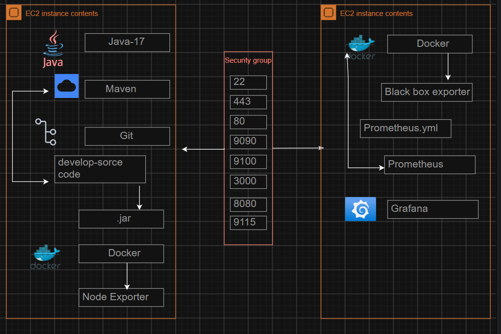

### Components

- Amazon EC2 (Server 1 and Server 2)
- Java 17
- Apache Maven
- Git
- Docker
- Node Exporter
- Blackbox Exporter
- Prometheus
- Grafana
- Security Group

---

## Step 1: Launch the EC2 Instances

Navigate to **EC2 → Instances** and launch two instances.

Configure:

- AMI: **Ubuntu**
- Version: **Ubuntu Server 26.04**
- Instance Type: **c7i-flex.large**
- VPC: **Default VPC**
- Security Group: **Prometheus-grafana-sg**
- Storage: **30 GiB**

Server 1 runs the Java application and Node Exporter. Server 2 runs Blackbox Exporter, Prometheus, and Grafana.

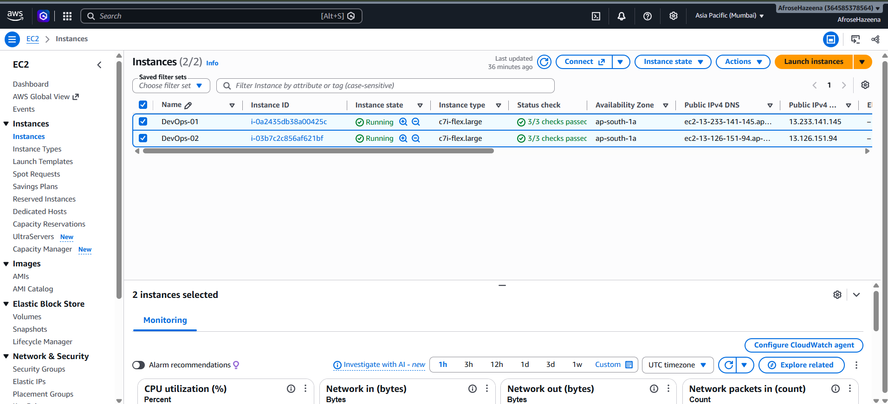

---

## Step 2: Configure the Security Group

Open the following inbound ports in the **Prometheus-grafana-sg** security group:

| Port | Service |
|------|---------|
| 22 | SSH |
| 80 / 443 | HTTP / HTTPS |
| 8080 | Java Application |
| 9100 | Node Exporter |
| 9115 | Blackbox Exporter |
| 9090 | Prometheus |
| 3000 | Grafana |

The security group allows the servers and the browser to reach each service.

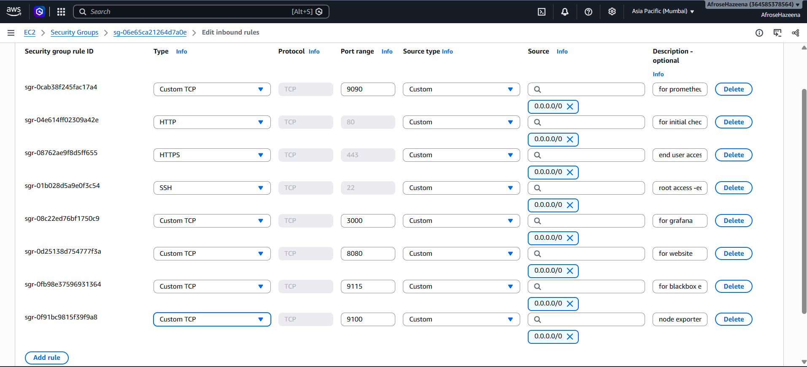

---

## Step 3: Connect to Server 1 and Install the Prerequisites

Connect to Server 1 using SSH and install Java 17, Maven, and Git.

```bash
ssh -i "<your-key>.pem" ubuntu@<SERVER1_PUBLIC_DNS>
sudo -i
apt update

apt install openjdk-17-jre-headless -y
apt install maven -y
git --version
```

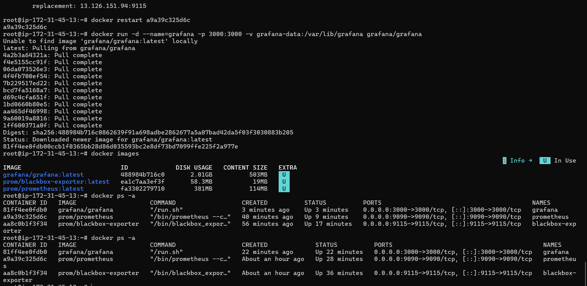

---

## Step 4: Clone and Build the Application

Clone the application from GitHub and build it with Maven.

```bash
git clone https://github.com/Senthil6005/Prometheus_Grafana_Project.git
cd Prometheus_Grafana_Project
mvn package
```

Maven creates a **target** folder that contains the packaged application.

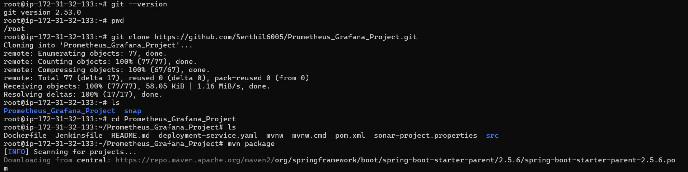

---

## Step 5: Run the Application

Run the packaged JAR file.

```bash
cd target
java -jar database_service_project-0.0.5-SNAPSHOT.jar
```

The JAR file is a single packaged application.

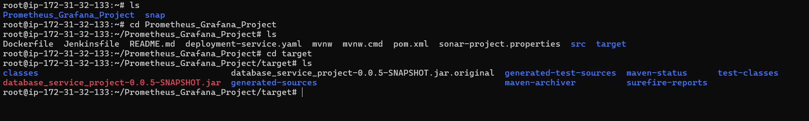

Open `http://<SERVER1_PUBLIC_IP>:8080` in the browser to access the application.

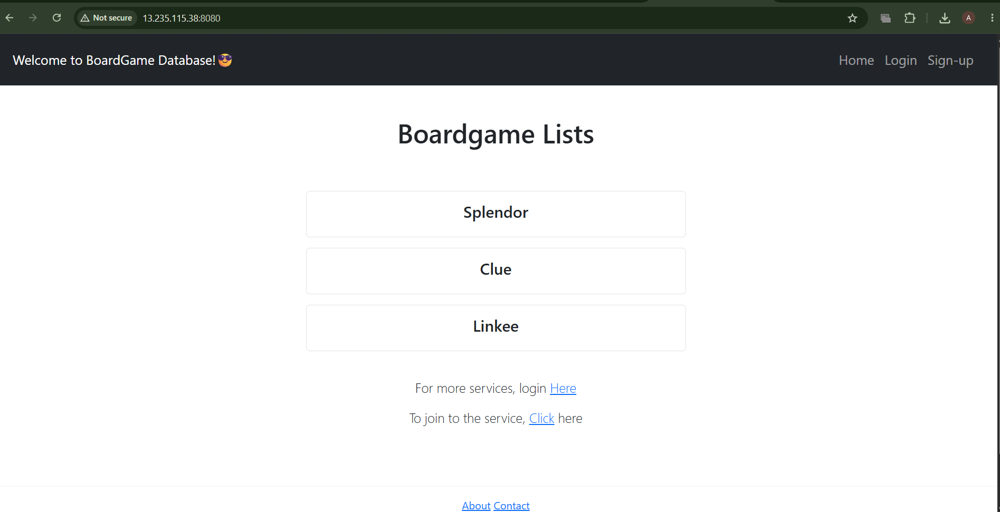

---

## Step 6: Run Node Exporter on Server 1

Install Docker and run Node Exporter as a container.

```bash
apt install docker.io -y

docker run -d \
  --name=node-exporter \
  -p 9100:9100 \
  --restart=always \
  --pid="host" \
  prom/node-exporter
```

Verify with `docker ps -a`, then open `http://<SERVER1_PUBLIC_IP>:9100` and click **Metrics**.

Node Exporter provides CPU, memory, disk, and network metrics of the server.

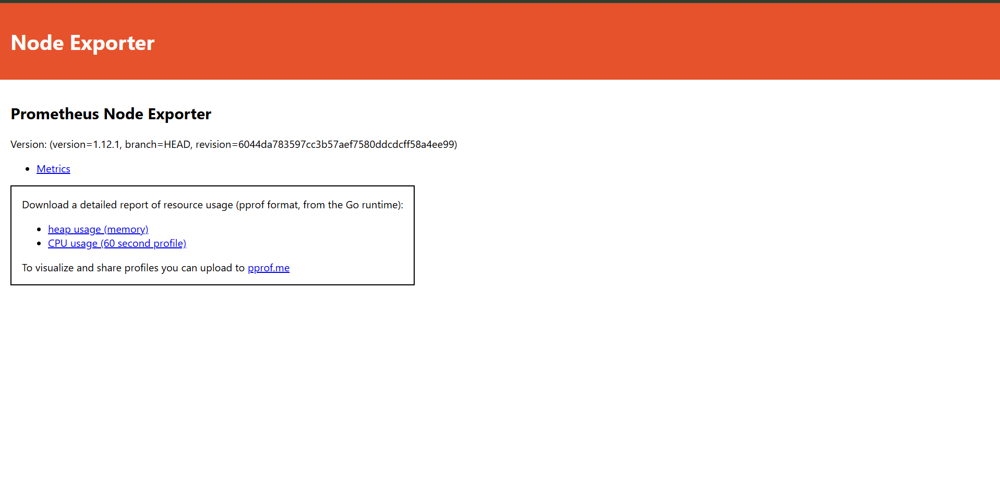

---

## Step 7: Run Blackbox Exporter on Server 2

Connect to Server 2, install Docker, and run Blackbox Exporter as a container.

```bash
ssh -i "<your-key>.pem" ubuntu@<SERVER2_PUBLIC_DNS>
sudo -i
apt update
apt install docker.io -y
```

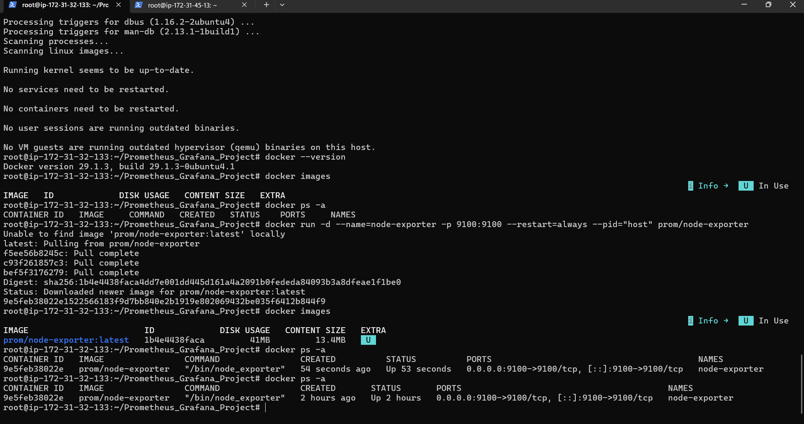

```bash
docker run -d --name=blackbox-exporter -p 9115:9115 prom/blackbox-exporter
```

Open `http://<SERVER2_PUBLIC_IP>:9115` to verify. Blackbox Exporter checks whether a website is up and measures its response time.

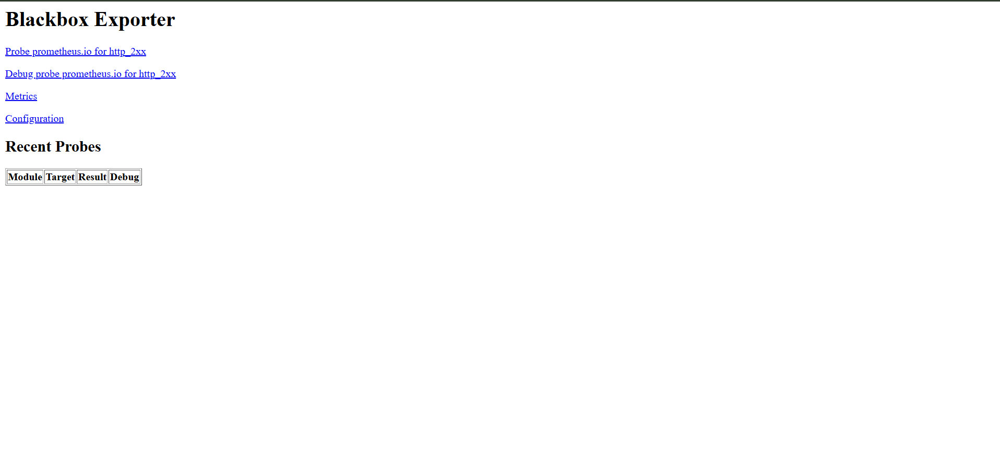

---

## Step 8: Configure and Run Prometheus

Create the `prometheus.yml` file. It tells Prometheus where to scrape the metrics from.

```bash
vi /root/prometheus.yml
```

```yaml
global:
  scrape_interval: 15s
  evaluation_interval: 15s

scrape_configs:
  - job_name: prometheus
    static_configs:
      - targets:
          - localhost:9090

  - job_name: node-exporter
    static_configs:
      - targets:
          - <SERVER1_PUBLIC_IP>:9100

  - job_name: blackbox-exporter
    metrics_path: /probe
    params:
      module: [http_2xx]
    static_configs:
      - targets:
          - http://<SERVER1_PUBLIC_IP>:8080/
          - https://www.annauniv.edu/
          - https://www.swiggy.com/
    relabel_configs:
      - source_labels: [__address__]
        target_label: __param_target
      - source_labels: [__param_target]
        target_label: instance
      - target_label: __address__
        replacement: <SERVER2_PUBLIC_IP>:9115
```

Run Prometheus as a container.

```bash
docker run -d \
  --name prometheus \
  -p 9090:9090 \
  -v /root/prometheus.yml:/etc/prometheus/prometheus.yml:ro \
  prom/prometheus
```

After editing `prometheus.yml`, restart the container with `docker restart prometheus`.

Open `http://<SERVER2_PUBLIC_IP>:9090` to access the Prometheus UI.

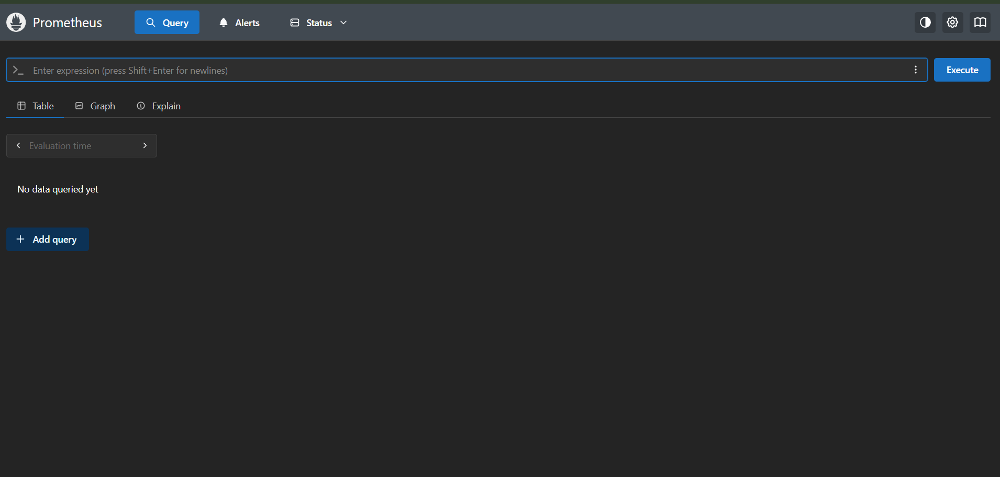

---

## Step 9: Verify Prometheus Targets

Navigate to **Status → Target health** in Prometheus.

Both Node Exporter and Blackbox Exporter should be connected and shown as **UP**.

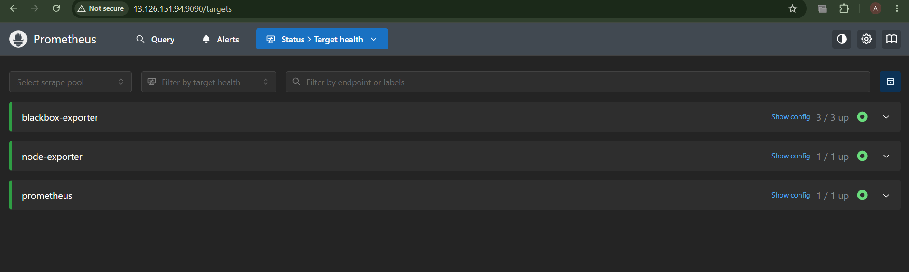

---

## Step 10: Run Grafana

Pull the Grafana image and run it as a container on Server 2.

```bash
docker run -d \
  --name=grafana \
  -p 3000:3000 \
  -v grafana-data:/var/lib/grafana \
  grafana/grafana
```

Verify all the containers on Server 2.

```bash
docker images
docker ps -a
```

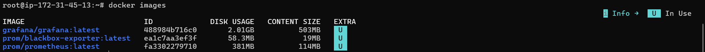

---

## Step 11: Connect Prometheus and Create the Dashboards

Open `http://<SERVER2_PUBLIC_IP>:3000`, log in, and set a new username and password.

**Add the data source:**

- Navigate to **Connections → Data sources → Add data source**
- Select **Prometheus**
- Connection URL: `http://<SERVER2_PUBLIC_IP>:9090`
- Click **Save & test**

**Import the dashboards:**

- Navigate to **Dashboards → New → Import**
- Paste the dashboard ID and click **Load**
- Create two dashboards:
  - **Node Exporter Full** (server CPU, memory, disk, and network)
  - **Blackbox Exporter** (website uptime and response time)

The dashboard IDs can be found by searching "node exporter full grafana dashboard" and "blackbox exporter grafana dashboard" on grafana.com.

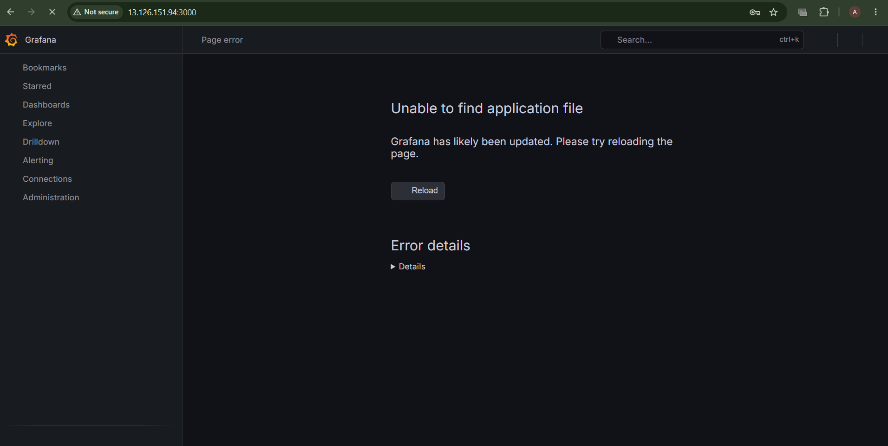

---

## Conclusion

In this lab, we:

- Launched two EC2 instances and configured the security group.
- Installed Java 17, Maven, and Git.
- Built the Java application with Maven and deployed it.
- Ran Node Exporter to monitor server resources.
- Ran Blackbox Exporter to monitor application availability.
- Configured Prometheus to scrape both exporters.
- Connected Prometheus to Grafana and imported the dashboards.

Prometheus and Grafana together give a complete view of application health, server performance, and uptime, helping us detect problems early and keep the application highly available.
